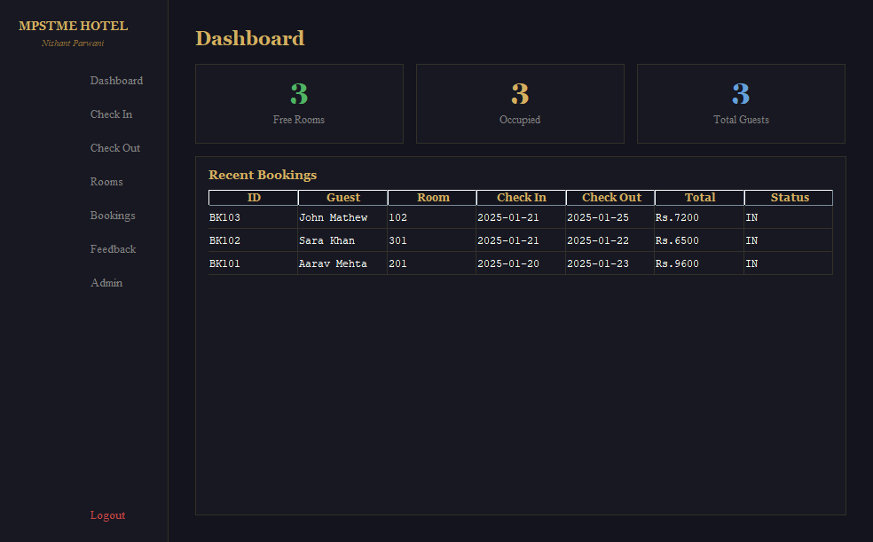
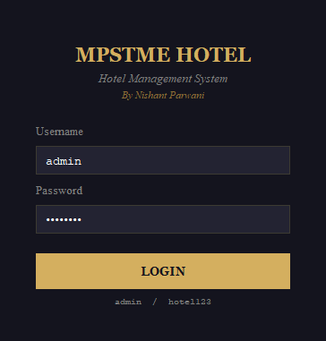
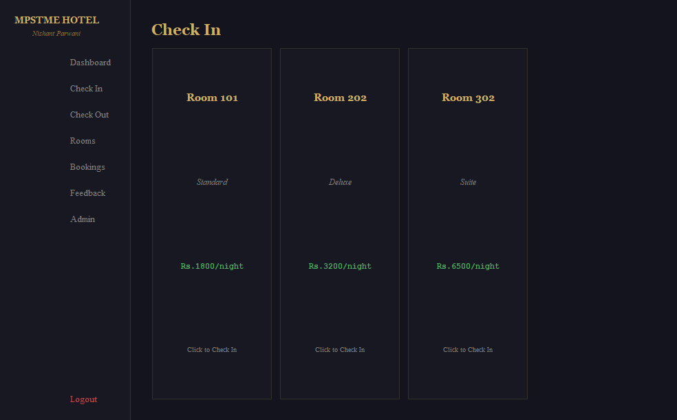
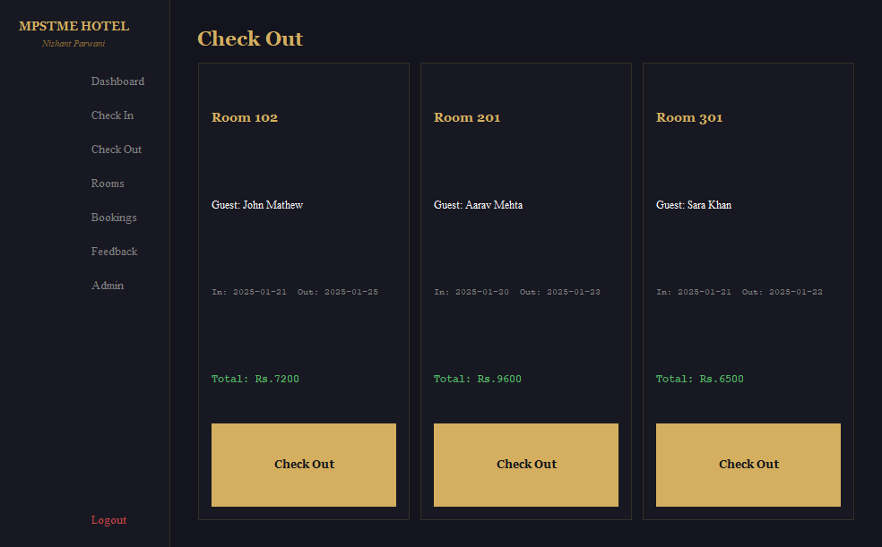
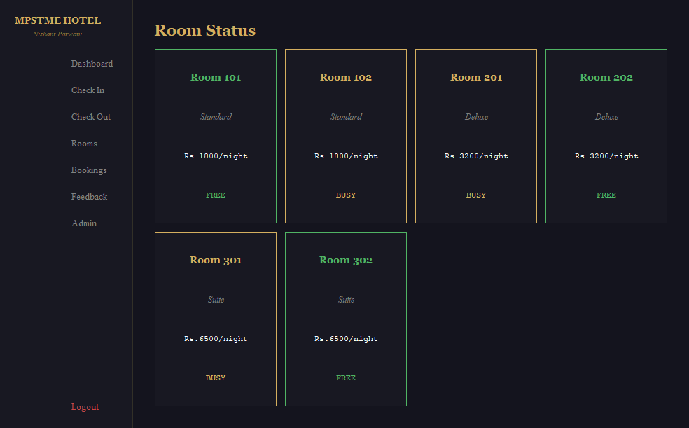
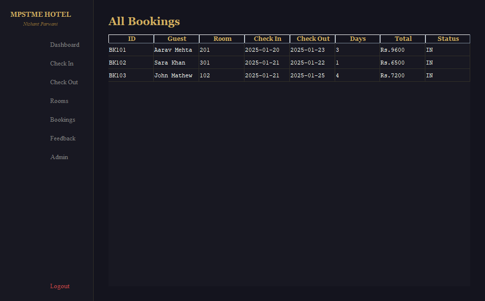
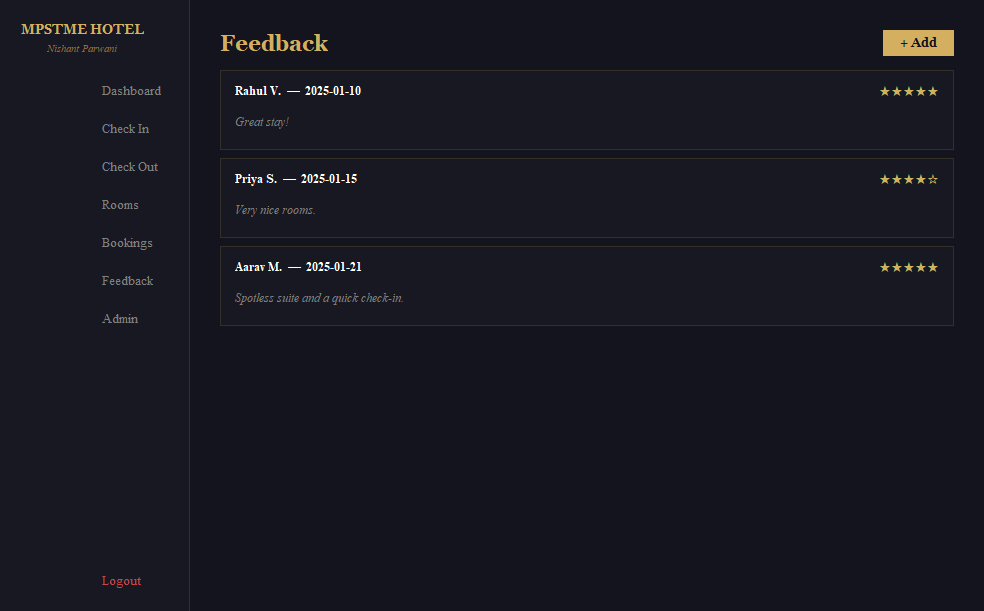
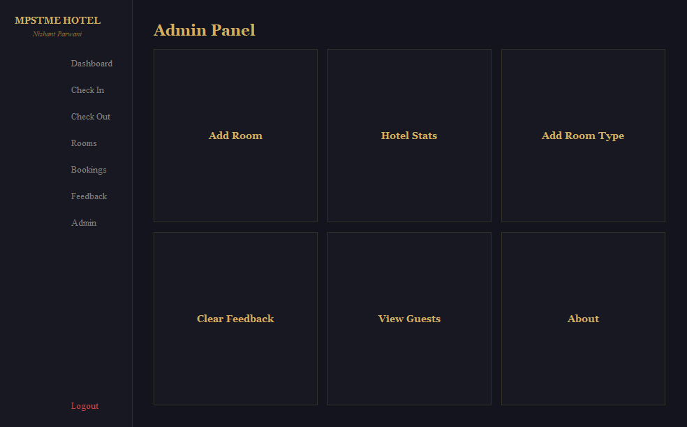

<div align="center">

# 🏨 MPSTME Hotel

### A complete front desk in pure Java — check-in to the final bill, in one window

**A desktop hotel management system built with nothing but Java and Swing: live room board, check-in and
check-out with an itemised bill, bookings, guest feedback and an admin panel. No database, no frameworks — just clean OOP.**




</div>

---

## What you can do

| | |
|---|---|
| 📊 **Dashboard** | Free vs occupied rooms, guests in house, recent bookings at a glance |
| 🛎️ **Check in** | Pick a free room (Standard · Deluxe · Suite), enter the guest and dates; nights and amount are worked out for you |
| 🧾 **Check out** | One click per occupied room produces an itemised bill and frees the room |
| 🚪 **Rooms** | Every room with its type, nightly rate and live FREE / BUSY status |
| 📚 **Bookings** | Full history with booking IDs (`BK101`, `BK102`, …) |
| ⭐ **Feedback** | Guests leave a 1–5 star rating and a comment |
| 🛠️ **Admin** | Add rooms and room types, hotel statistics, view guests, clear feedback |

## Screenshots

| Sign in | Check in |
|---|---|
|  |  |
| **Check out** | **Rooms** |
|  |  |
| **Bookings** | **Feedback** |
|  |  |

<details><summary>Admin panel</summary>



</details>

## Run it

You only need a JDK (17 or newer).

```bash
javac *.java
java Main
```

On Windows just double-click **`run.bat`**. Sign in with **`admin` / `hotel123`**.

## How it's built

```
Main.java       entry point + the model: Room, Booking, Feedback, HotelData (in-memory store, sample rooms)
LoginDash.java  Login window and the Dashboard frame with its sidebar navigation
Screens.java    Home, Check In and Check Out panels (billing)
Panels.java     Rooms, Bookings, Feedback and Admin panels
```

Every Java concept the course covers appears in a real feature, and each one is labelled in the code
(`// Unit 3: Class, constructor, objects`):

| Concept | Where it shows up |
|---|---|
| Classes, objects, constructors, static members | `Room`, `Booking`, `Feedback`, `HotelData` |
| Selection and iteration | Room availability, the navigation ladder, billing loops |
| Strings and `StringBuffer` | Booking IDs, the admin guest list |
| Exception handling and input validation | Check-in form, adding a room with its rate |
| Swing: `JFrame`, `JPanel`, `JDialog`, layouts, `JTable` | Every screen |
| Event handling: `ActionListener`, `MouseListener` | Buttons, hover effects, room cards |
| Collections: `ArrayList`, for-each | Rooms, bookings and feedback lists |

## Ideas for next steps

Save data to a file or SQLite so it survives a restart · printable PDF invoices · date pickers · per-staff logins.

---

<sub>Built for an Object-Oriented Programming in Java course. Guests and bookings in the screenshots are sample data.</sub>
